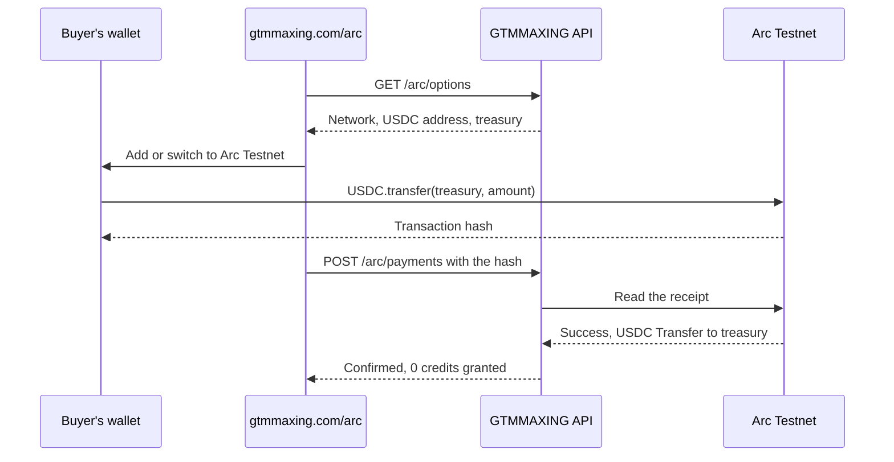

# USDC on Arc: a test checkout

GTMMAXING sells credits for USDC, and buyers on other chains need a swap, a bridge and gas in a second token.
On Arc, USDC is both the money and the gas, and payments are final in under a second, so one wallet transfer is the whole checkout.
`/arc/` offers that path on Arc Testnet alongside the live Uniswap checkout.

## How it works

## Rules it follows

- **Test USDC never buys credits.** It's free from a faucet, so `credits_granted` is always 0 and the page says so before anyone pays. It shows what the amount would buy in real USDC, for comparison only.
- **Only the chain counts.** A payment is recorded only when its receipt shows a successful USDC `Transfer` to the treasury, and a transaction can be claimed by one account only.
- **One decimal system.** Arc's native USDC has 18 decimals and its ERC-20 interface has 6, over one shared balance, so this code only ever uses the ERC-20 interface.
- **A failed read isn't a failed payment.** If Arc can't be reached, the page checks again and never asks the wallet to send twice.

## Where things live

| Piece | Code |
| --- | --- |
| Network constants and contracts | `packages/contracts/src/arc.ts` |
| Reading receipts | `api/src/payments/arc.ts` |
| Rules | `api/src/application/arc-checkout.ts` |
| Routes | `api/src/routes/arc.ts` |
| Page | `web/src/features/arc/ArcPage.tsx` |
| Tests | `api/test/arc-checkout.test.ts`, `web/src/features/arc/ArcPage.test.tsx` |

## Arc Studio

The same checkout was also built and deployed from Arc Studio, and its exported source is in [`arc-studio/`](../arc-studio/).
It sends one USDC transfer to the same treasury and shows a receipt read from the confirmed transaction.
Share link: https://studio.arc.io/share/gtmmaxing-usdc-credit-checkout-2kif6xoiet
Deployed app: https://arc-studio-ca8f39474dfb448abe4cbc25.vercel.app/
A real test payment on that app: https://explorer.testnet.arc.io/tx/0xc46b34450d31d0d1795f16563bdb47ef05fb804e2ceba7a2d36154e8f83a98d9
